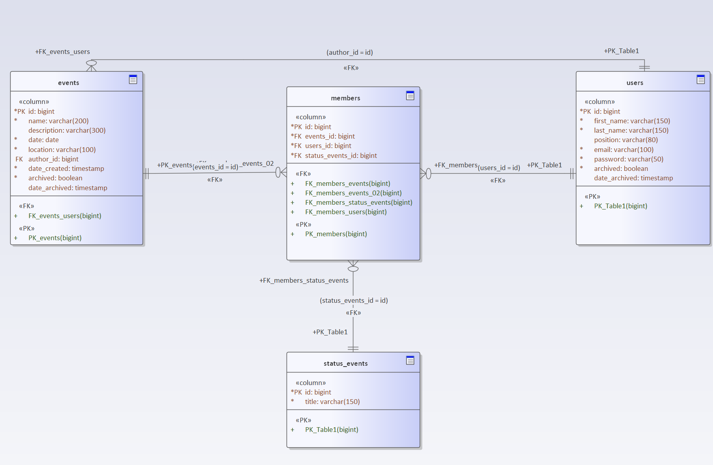

# Физическая модель данных

Ниже представлена ER-диаграмма и описание структуры базы данных.

## Таблица `events` (мероприятия)

| Параметр | Тип | Обязательность | Описание |
| :--- | :--- | :--- | :--- |
| id | bigint | True | Идентификатор записи мероприятия |
| name | varchar(200) | True | Наименование мероприятия |
| description | varchar(300) | False | Описание мероприятия |
| date | date | True | Дата мероприятия |
| location | varchar(80) | True | Место проведения мероприятия |
| author_id | bigint | True | Идентификатор автора мероприятия |
| date_created | timestamp | True | Дата создания мероприятия |
| archived | boolean | True | Признак архивности |
| date_archived | timestamp | False | Дата архивации записи |

## Таблица `members` (участники мероприятия)

| Параметр | Тип | Обязательность | Описание |
| :--- | :--- | :--- | :--- |
| id | bigint | True | Идентификатор записи участника |
| events_id | bigint | True | Идентификатор записи мероприятия |
| users_id | bigint | True | Идентификатор записи пользователя |
| status_events_id | bigint | True | Идентификатор записи статуса |

## Таблица `users` (пользователи)

| Параметр | Тип | Обязательность | Описание |
| :--- | :--- | :--- | :--- |
| id | bigint | True | Идентификатор записи пользователя |
| first_name | varchar(150) | True | Имя пользователя |
| last_name | varchar(150) | True | Фамилия пользователя |
| position | varchar(80) | False | Должность пользователя |
| email | varchar(100) | True | Электронная почта пользователя |
| password | varchar(50) | True | Пароль пользователя |
| archived | boolean | True | Признак архивности |
| date_archived | timestamp | False | Дата архивации записи |

## Таблица `status_events` (статусы участия в мероприятии)

| Параметр | Тип | Обязательность | Описание |
| :--- | :--- | :--- | :--- |
| id | bigint | True | Идентификатор статуса участия в мероприятии |
| title | varchar(150) | True | Наименование статуса |
‌
